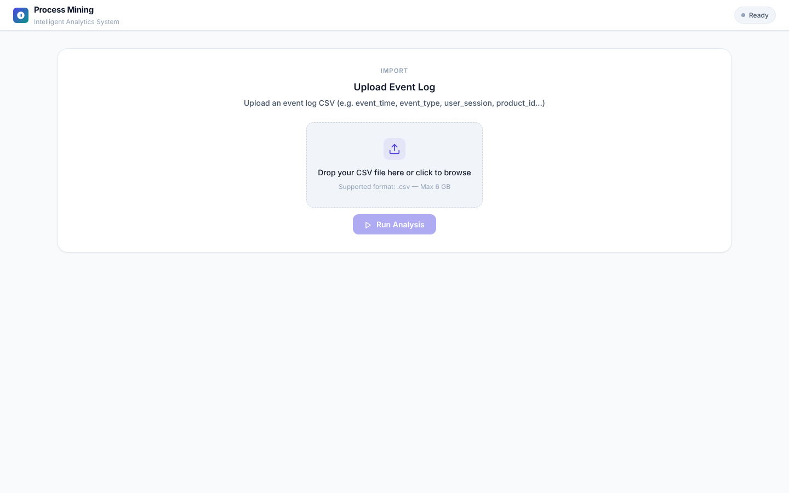
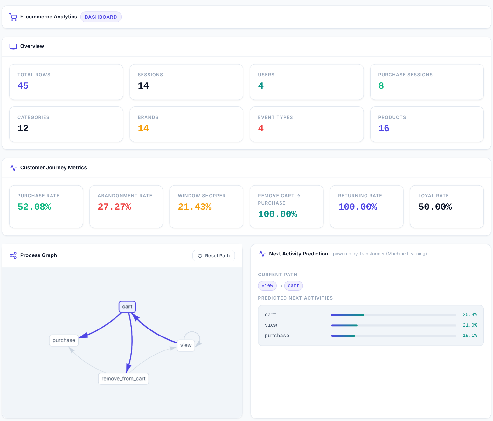
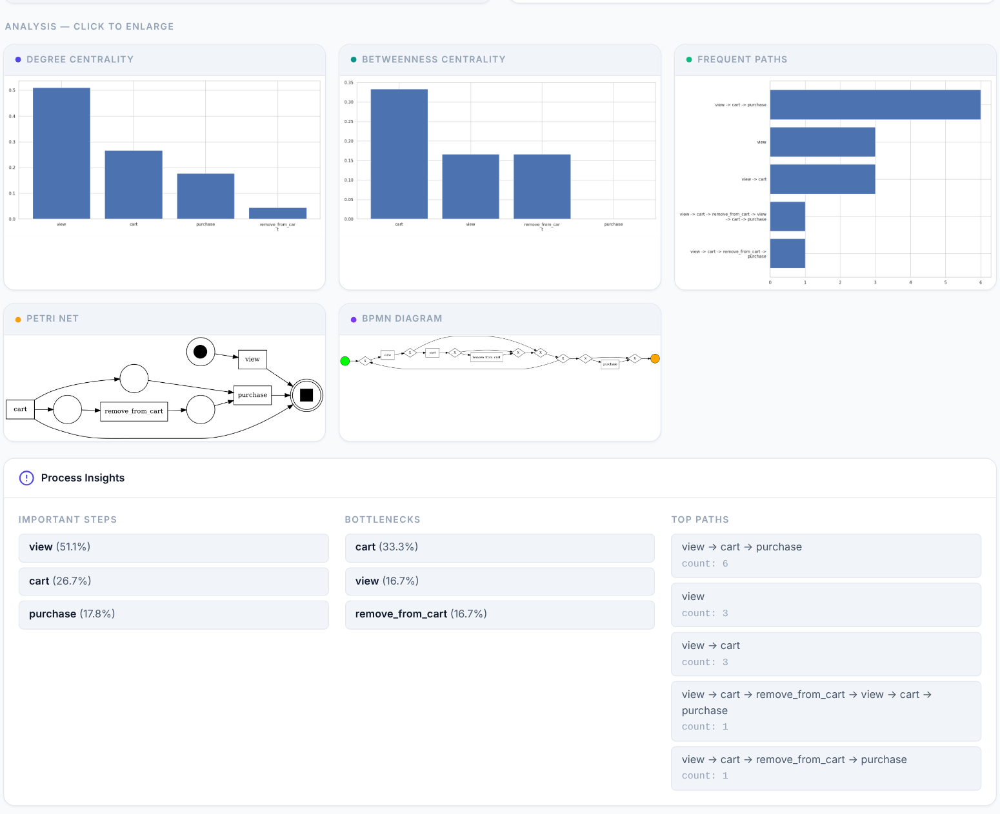
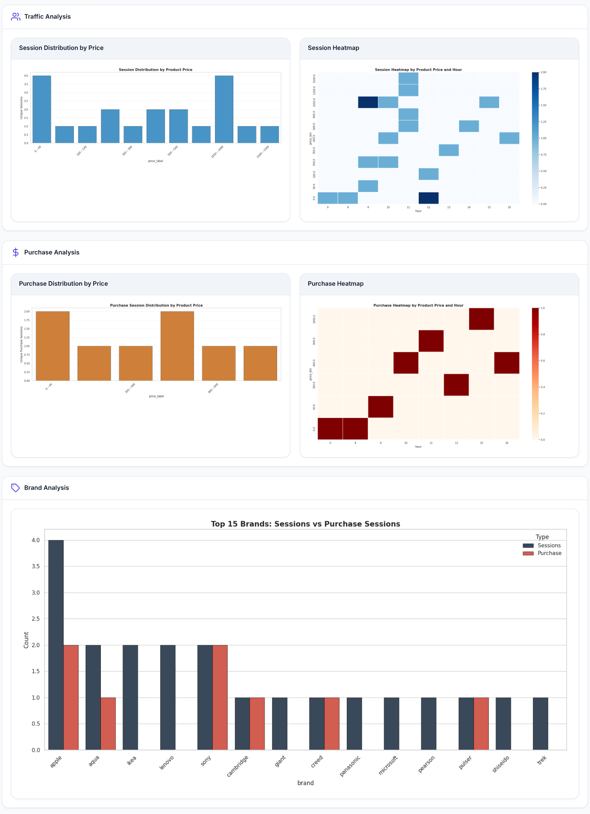

# E-Business Process Mining System

> Turn raw e-commerce clickstream logs into process models, KPIs, next-step predictions and AI-generated insights.

    

| | |
|---|---|
| **Type** | Full-stack data & AI web application |
| **Domain** | E-commerce analytics, process mining |
| **Highlights** | Process discovery (Petri net / BPMN), Transformer next-action prediction, LLM chatbot, multi-GB CSV support |

**Contents:** [Overview](#-overview) · [Key Features](#-key-features) · [Screenshots](#-screenshots) · [Tech Stack](#-tech-stack) · [Architecture](#-architecture) · [Project Structure](#-project-structure) · [Getting Started](#-getting-started) · [Configuration](#-configuration) · [Notes & Roadmap](#-notes--roadmap)

## 📖 Overview

Upload an event log (`view` → `cart` → `purchase`, grouped by user session) and the system:

1. discovers the shopping process with **process mining** algorithms,
2. analyses the session graph and e-commerce KPIs,
3. trains a **Transformer** model to predict a customer's next action,
4. answers questions about the findings through a **Gemini**-powered chatbot.

Large files are handled with lazy/streaming loading (Polars) and session-level sampling, so multi-GB CSVs run on a normal machine.

## ✨ Key Features

- **Process discovery**: Alpha Miner and Inductive Miner, rendered as Petri nets and BPMN diagrams (pm4py + Graphviz)
- **Graph mining**: session transition graph with centrality metrics (NetworkX)
- **E-commerce dashboard**: funnel, conversion, category, brand and price charts (Matplotlib, Seaborn)
- **Next-activity prediction**: Transformer trained on session sequences (TensorFlow/Keras), served at `/api/predict`
- **LLM insights and chat**: Gemini summarises results and answers follow-ups (optional, needs an API key)
- **Large-file friendly**: uploads up to 6 GB, with configurable caps on rows and sessions

## 📸 Screenshots

Results below come from the sample log in [`data/dataset.csv`](data/dataset.csv) (45 events, 14 sessions), so the numbers are small and illustrative. Large logs work the same way.

### 1. Upload an event log



### 2. KPI dashboard, process graph and next-activity prediction

Overview and customer-journey KPIs (purchase rate, abandonment, window shoppers, returning/loyal rate). Click a node in the process graph to build a path; the Transformer returns the probability of each next activity (here `view → cart`).



### 3. Process discovery

Graph centrality, frequent paths, Petri net and BPMN diagram discovered with pm4py, plus automatically derived important steps, bottlenecks and top paths.



### 4. E-commerce analytics

Session and purchase distribution by price and hour, and sessions vs purchases per brand.



The Gemini-powered insight and chat panels need your own `GEMINI_API_KEY` (see [Configuration](#-configuration)) and are not shown here.

## 🛠 Tech Stack

| Layer | Technology |
|---|---|
| Web UI / gateway | Java 17, Spring Boot, Thymeleaf, JavaScript |
| Analytics service | Python 3.10/3.11, Flask, Polars, pandas, NumPy |
| Process mining | pm4py, NetworkX, Graphviz |
| Machine learning | TensorFlow / Keras, scikit-learn |
| LLM | Google Gemini (`google-genai`) |

## 🏗 Architecture

```
Browser ──▶ web-app (Spring Boot :8080) ──▶ analytics-service (Flask :5000)
                │                                   │
                └──── shared folder: data/ ◀────────┘
```

The Spring Boot app serves the UI and forwards requests to the Flask service. Uploaded CSV files are written to `data/`, which both services share.

## 📁 Project Structure

```
e-business-system/
├── analytics-service/
│   ├── app.py                    # Flask API: mining, dashboard, prediction, LLM
│   ├── app_with_evaluation.py    # Same API + /api/evaluation/download
│   └── requirements.txt
├── web-app/                      # Spring Boot app (Maven wrapper included)
│   └── src/main/{java,resources}
├── data/
│   └── dataset.csv               # small sample event log
└── docs/images/                  # README screenshots
```

## 🚀 Getting Started

### Prerequisites

- Java 17+
- Python 3.10 or 3.11
- [Graphviz](https://graphviz.org/download/) installed on the OS and on `PATH`
- About 8 GB free RAM for large CSV files

### Installation and run

**1. Analytics service**

```bash
cd analytics-service
python -m venv venv
source venv/bin/activate          # Windows: venv\Scripts\activate
pip install -r requirements.txt   # no GPU? replace tensorflow with tensorflow-cpu
python app.py                     # http://localhost:5000 → "API is running!"
```

**2. Web app**

```bash
cd web-app
./mvnw spring-boot:run            # Windows: mvnw.cmd spring-boot:run
```

Open <http://localhost:8080>, upload a CSV (try `data/dataset.csv`) and wait for the dashboard.

**Input format:** CSV with at least `event_time, event_type, product_id, category_code, category_id, brand, price, user_id, user_session`.

## ⚙️ Configuration

| Setting | Where | Default | Purpose |
|---|---|---|---|
| `GEMINI_API_KEY` | env var (Python) | unset | Enables LLM insights and chat; the rest works without it |
| `DATASET_DIR` | env var (Python) | `../data` | Folder with uploaded event logs |
| `python.api.base-url` | `application.properties` | `http://localhost:5000` | Address of the analytics service |
| `dataset.dir` | `application.properties` | `../data` | Must match `DATASET_DIR` |
| `MAX_ROWS_FOR_PROCESS_MINING`, `MAX_SESSIONS_FOR_TRAINING` | top of `app.py` | 1.1M / 200k | Lower for weaker machines |

```bash
export GEMINI_API_KEY="your-key"   # PowerShell: $env:GEMINI_API_KEY="your-key"
```

## 📝 Notes & Roadmap

- **Troubleshooting:** `Program dot not found` means Graphviz is missing from `PATH`; `Connection refused` means the Flask service is down or `python.api.base-url` is wrong; out-of-memory on huge files means lowering the caps above.
- `app.py` and `app_with_evaluation.py` share most code; merging them is the next refactor.
- The bundled dataset is tiny. Use a real e-commerce event log for meaningful models.
